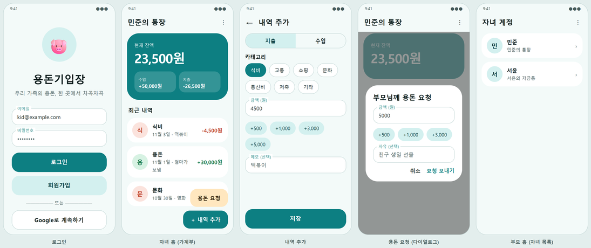
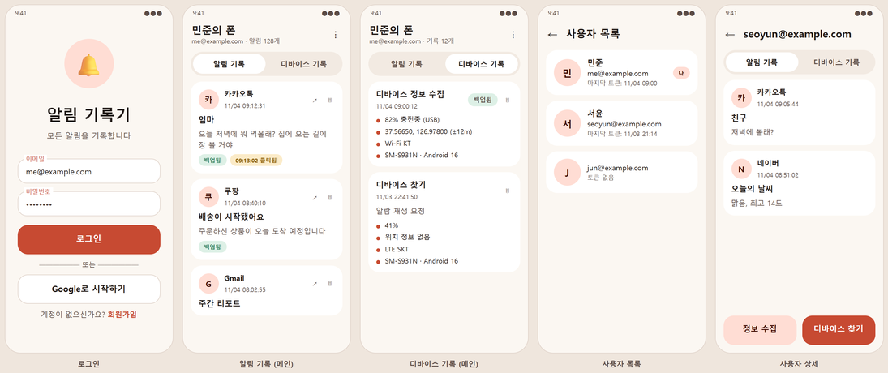
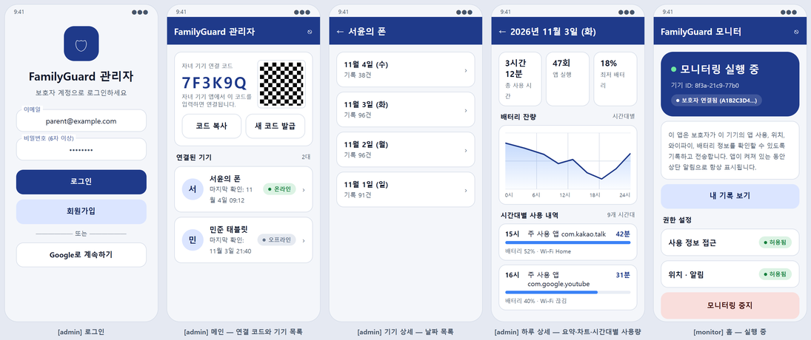
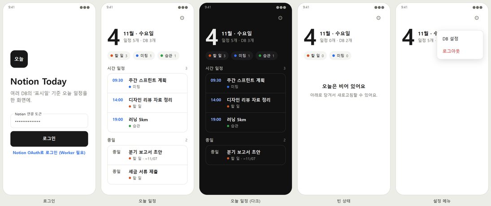
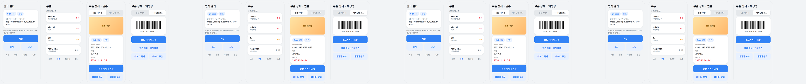
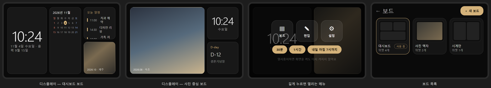

# dock

내 안드로이드 앱의 최신 APK를 올려 두는 **공개 배포 저장소**입니다. 이 저장소에는 코드가 없고, 설치 파일은 [Releases](https://github.com/parkhaas/dock/releases)에서 받습니다. 아래에는 배포되는 앱과, 같은 사람이 공개한 웹 프로젝트를 한곳에 모아 소개합니다.

## 배포 방식

- 앱마다 Release 하나(태그 = 앱 이름)를 두고, 각 앱의 GitHub Actions가 빌드 뒤 APK와 `version.json`을 **덮어씁니다**. 최신 파일만 남습니다.
- 앱은 토큰 없이 `https://github.com/parkhaas/dock/releases/download/<앱 이름>/version.json`을 읽어 새 버전을 확인하고, 앱 안에서 업데이트합니다.
- 버전: `versionName = major.minor.patch_yyMMdd_HHmm`(KST 빌드 시각), `versionCode = major*999*10000 + minor*10000 + patch`. Android 8.0(API 26) 이상.
- 설치: 아래 표의 릴리스 링크에서 APK를 받아 설치합니다(출처를 알 수 없는 앱 허용 필요). 같은 서명이라 덮어쓰기 업데이트됩니다.

## 안드로이드 앱

| 앱 | 한 줄 소개 | 릴리스 | 최신 버전 |
|---|---|---|---|
| **BudgetBook** | 아이와 부모가 함께 쓰는 용돈기입장. 자녀 앱은 수입·지출을 기록하고 용돈을 요청하고, 부모 앱은 용돈(정기 포함)을 보냅니다. | [`BudgetBook`](https://github.com/parkhaas/dock/releases/tag/BudgetBook) [`BudgetBookClient`](https://github.com/parkhaas/dock/releases/tag/BudgetBookClient) | `v0.0.7_261113_1043` `v0.0.7_261113_1043` |
| **RecordNoti** | 기기의 알림과 상태를 기록하는 모니터 앱과, 그 기록을 보며 푸시·디바이스 찾기를 보내는 관리자 앱. | [`RecordNoti`](https://github.com/parkhaas/dock/releases/tag/RecordNoti) | `v0.0.7_261113_1041` |
| **FamilyGuard** | 자녀 기기의 앱 사용·배터리·와이파이·위치를 투명하게 기록하고, 보호자가 확인하는 2앱. | [`familyguard`](https://github.com/parkhaas/dock/releases/tag/familyguard) | `v0.0.19_261113_1041` |
| **Notion Today** | 여러 Notion DB의 '표시일' 기준 오늘 일정을 한 화면과 홈 위젯으로 모아 보는 앱. | [`notion_cal`](https://github.com/parkhaas/dock/releases/tag/notion_cal) | `v0.0.13_261113_1056` |
| **codeManager** | 바코드/QR을 열지 않고 읽어 보여주고, 쿠폰을 보관하며 만료를 알려 주는 앱. | [`codeManager`](https://github.com/parkhaas/dock/releases/tag/codeManager) | `v0.0.4_261113_1055` |
| **전자액자** | 태블릿을 항상 켜진 전자액자·정보 디스플레이로 만드는 위젯 보드 앱. | [`photo-frame`](https://github.com/parkhaas/dock/releases/tag/photo-frame) | `v0.2.3_261113_1041` |

각 앱의 상세 설명은 아래를 펼쳐 보세요. (앱 소스 저장소는 비공개라 README 링크는 소유자만 열립니다.)

<b>BudgetBook (용돈기입장)</b> — 아이와 부모가 함께 쓰는 용돈기입장. 자녀 앱은 수입·지출을 기록하고 용돈을 요청하고, 부모 앱은 용돈(정기 포함)을 보냅니다.

자녀는 수입·지출을 간단히 기록하고 부모에게 용돈을 요청하고, 부모는 연결된 자녀의 내역을 보며 용돈(정기 용돈 포함)을 보내는 Android 앱입니다. 큼직한 둥근 모서리와 밝은 청록(테마 "저금통")으로 아이도 쉽게 쓰게 만들었고, 잔액을 가장 크게 보여줍니다. 부모 앱이 보여주는 QR로 자녀 앱을 가족에 연결합니다.

| 구성 | 패키지 | 설치 대상 |
|---|---|---|
| `client-app` | `com.parkhaas.budgetbook.client` | 자녀 기기 |
| `admin-app` | `com.parkhaas.budgetbook.admin` | 부모 기기 |
| `core` | `com.parkhaas.budgetbook.core` | (라이브러리) |

주요 화면(디자인 샘플):

릴리스: [`BudgetBook`](https://github.com/parkhaas/dock/releases/tag/BudgetBook) (부모(관리자) 앱), [`BudgetBookClient`](https://github.com/parkhaas/dock/releases/tag/BudgetBookClient) (자녀 앱)

소스·전체 README: [parkhaas/BudgetBook](https://github.com/parkhaas/BudgetBook) (비공개)

<b>RecordNoti — 알림 모니터 + 알림 관리자</b> — 기기의 알림과 상태를 기록하는 모니터 앱과, 그 기록을 보며 푸시·디바이스 찾기를 보내는 관리자 앱.

**모니터 앱**은 기록할 기기에 설치해 알림과 기기 상태(배터리·위치·네트워크)를 기록하고, **관리자 앱**은 보는 기기에서 그 기록을 실시간으로 조회하고 "정보 수집"·"디바이스 찾기" 푸시를 보냅니다. 6자리 코드 또는 QR로 연결합니다. 따뜻한 종이 바탕에 산호 액센트(테마 "따뜻한 종이, 산호")로 알림 기록을 일기장처럼 읽도록 디자인했습니다.

| 구성 | 패키지 | 설치 대상 |
|---|---|---|
| `monitor-app` | `com.parkhaas.recordnoti` | 기록할 기기 |
| `admin-app` | `com.parkhaas.recordnoti.admin` | 보는 기기 |
| `core` | `com.parkhaas.recordnoti.core` | (라이브러리) |

주요 화면(디자인 샘플):

릴리스: [`RecordNoti`](https://github.com/parkhaas/dock/releases/tag/RecordNoti) (모니터·관리자 두 앱을 한 릴리스에 함께)

소스·전체 README: [parkhaas/RecordNoti](https://github.com/parkhaas/RecordNoti) (비공개)

<b>FamilyGuard — 투명한 자녀 기기 사용 모니터링</b> — 자녀 기기의 앱 사용·배터리·와이파이·위치를 투명하게 기록하고, 보호자가 확인하는 2앱.

**모니터 앱**(자녀 기기)이 앱 사용, 와이파이, 배터리, (선택) 위치를 15분마다 기록해 올리고, **관리자 앱**(보호자 기기)이 그 기록을 날짜별·시간대별로 보여줍니다. 숨김 앱이 아니며, 실행 중에는 "모니터링 중" 알림이 항상 표시됩니다. 중지·로그아웃은 보호자 코드로 확인합니다.

| 구성 | 패키지 | 설치 대상 |
|---|---|---|
| `monitor-app` | `com.familyguard.monitor` | 자녀 기기 |
| `admin-app` | `com.familyguard.admin` | 보호자 기기 |
| `core` | `com.familyguard.core` | (라이브러리) |

주요 화면(디자인 샘플):

릴리스: [`familyguard`](https://github.com/parkhaas/dock/releases/tag/familyguard) (모니터·관리자 두 앱을 한 릴리스에 함께)

소스·전체 README: [parkhaas/familyguard](https://github.com/parkhaas/familyguard) (비공개)

<b>Notion Today (Android)</b> — 여러 Notion DB의 '표시일' 기준 오늘 일정을 한 화면과 홈 위젯으로 모아 보는 앱.

Notion의 여러 데이터베이스에서 '표시일'이 오늘인(기간 일정은 종료일이 오늘 이후인) 항목을 모아 시간 일정과 종일 일정으로 나눠 보여줍니다. DB별로 날짜 속성 이름을 바꿀 수 있고, 4x2 홈 화면 위젯으로도 볼 수 있습니다. 종이 위의 잉크 느낌의 라이트/다크 테마를 씁니다.

| 구성 | 패키지 | 설치 대상 |
|---|---|---|
| `app` | `com.example.notiontoday` | 한 대의 기기 |
| `worker` | (Cloudflare Worker) | 서버 |

주요 화면(디자인 샘플):

릴리스: [`notion_cal`](https://github.com/parkhaas/dock/releases/tag/notion_cal) (단일 앱)

소스·전체 README: [parkhaas/notion_cal](https://github.com/parkhaas/notion_cal) (비공개)

<b>codeManager</b> — 바코드/QR을 열지 않고 읽어 보여주고, 쿠폰을 보관하며 만료를 알려 주는 앱.

링크를 열거나 요청을 보내지 않고 형식·내용 종류·원본 데이터만 보여주는 **열지 않는 코드 리더**이자 쿠폰 보관함입니다. 원본 이미지, 인식 데이터, 다시 만든 코드 이미지를 기기 안에만 저장하고, 쿠폰은 매장·만료일을 이미지에서 읽어 채웁니다. 만료 7일·3일·당일 알림과 위치 기반 "근처" 목록을 제공합니다.

| 구성 | 패키지 | 설치 대상 |
|---|---|---|
| `app` | `com.parkhaas.codemanager` | 한 대의 기기 |

주요 화면(디자인 샘플):

릴리스: [`codeManager`](https://github.com/parkhaas/dock/releases/tag/codeManager) (단일 앱)

소스·전체 README: [parkhaas/codeManager](https://github.com/parkhaas/codeManager) (비공개)

<b>전자액자 (PhotoFrame)</b> — 태블릿을 항상 켜진 전자액자·정보 디스플레이로 만드는 위젯 보드 앱.

사진, 시계, 월 달력, 오늘 일정, D-day, 문구 같은 위젯을 격자 보드에 배치해 태블릿에 항상 띄워 두는 앱입니다. 보드를 여러 개 만들어 바꿀 수 있고, mini_widgets 위젯 10종을 네이티브로 옮겼으며 웹 위젯 주소로도 위젯을 추가할 수 있습니다. 번인을 줄이는 Pixel Shift, 부팅·재점등·화면보호기(Dream)를 지원합니다. 순흑 바탕에 샴페인 골드 포인트(테마 "갤러리 블랙")로 사진이 주인공이 되게 했습니다.

| 구성 | 패키지 | 설치 대상 |
|---|---|---|
| `app` | `app.photoframe` | 태블릿 |

주요 화면(디자인 샘플):

릴리스: [`photo-frame`](https://github.com/parkhaas/dock/releases/tag/photo-frame) (단일 앱(태블릿))

소스·전체 README: [parkhaas/photo-frame](https://github.com/parkhaas/photo-frame) (비공개)

## 웹 프로젝트 (공개 URL)

APK가 아닌, 브라우저에서 바로 쓰는 공개 사이트입니다.

| 프로젝트 | 소개 | 링크 |
|---|---|---|
| **FP-Pilot (FLOVER-FLIX)** | 프로미스나인(fromis_9) 팬이 만드는 비영리 영상 아카이브. 음악방송·직캠·자체콘텐츠·스페셜무대·Shorts를 한곳에 모아 보는 정적 사이트로, YouTube 공식 API로 6시간마다 자동 수집하고 영상은 임베드만 합니다. 빌드 도구 없는 순수 HTML/CSS/JS, GitHub Pages 배포. | [parkhaas.github.io/fp-pilot](https://parkhaas.github.io/fp-pilot/) · [소스](https://github.com/parkhaas/fp-pilot) |
| **Mini Widgets** | Notion 등 웹페이지에 임베드해 쓰는 정적 미니 위젯 모음(시계·달력·D-day·진행률·날씨 등). GET 파라미터로 설정하고, 35종 공통 테마를 지원하며 각 위젯의 편집 화면에서 URL을 만들어 복사합니다. Vercel 배포. | [widget-eta-mocha.vercel.app](https://widget-eta-mocha.vercel.app/) |
